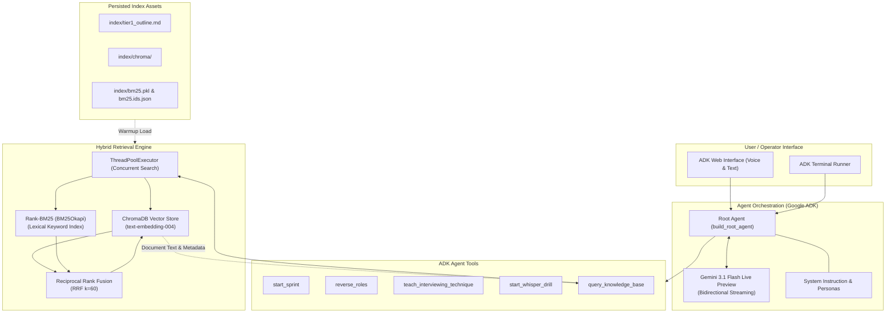
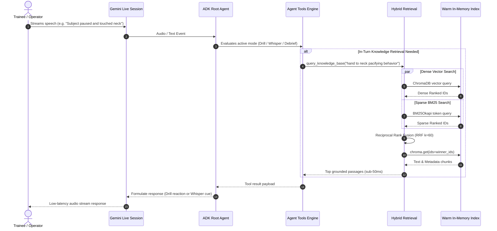

# System Architecture & Design: Agentic Ellipsis

This document provides a detailed architectural overview of the Agentic Ellipsis system, including the agent orchestration runtime, bidirectional live streaming model, hybrid retrieval engine, and warmup performance caching.

---

## 1. High-Level Component Topology

Agentic Ellipsis consists of three primary functional layers:
1. **Interactive Agent Layer:** Built on Google ADK (`google.adk.Agent`), interfacing with `gemini-3.1-flash-live-preview` for bidirectional streaming over WebRTC/WebSocket.
2. **Behavioral Simulation & Tools Engine:** Manages drill state, scenario selection, role-reversal, whisper coaching, and technique tutoring.
3. **Hybrid Retrieval & Indexing Engine:** Combines dense semantic vector search in ChromaDB with sparse lexical search via BM25, fused through Reciprocal Rank Fusion (RRF).



---

## 2. Agent Orchestration & Live Streaming

The conversational runtime is built with **Google ADK**:
- **Agent Assembly:** `build_root_agent()` in [`app/agent/agent.py`](../app/agent/agent.py) compiles the toolset, attaches the pre-warmed hybrid index, and injects dynamic system prompts.
- **Foundation Model:** `gemini-3.1-flash-live-preview` provides native audio support and bidirectional streaming (`bidiGenerateContent`), enabling natural voice interruptions, rapid turnarounds, and human-like conversational cadence.
- **System Instructions:** Defined in [`app/agent/instruction.py`](../app/agent/instruction.py), guiding the agent when to speak as the simulated subject, when to provide whisper coaching cues, and how to conduct structured debriefs with knowledge-grounded feedback.

---

## 3. Hybrid Retrieval Engine (Dense + Sparse Fusion)

To provide accurate retrieval over detailed element codes (such as BTOE codes `N-14`, `F-02`) alongside broad behavioral concepts, the system implements concurrent hybrid retrieval in [`app/retrieval/hybrid.py`](../app/retrieval/hybrid.py).

### Concurrent Query Execution
When `query_knowledge_base(query, top_k)` is triggered:
1. Two independent query tasks are dispatched concurrently via Python's `ThreadPoolExecutor(max_workers=2)`:
   - **Dense Semantic Query:** ChromaDB queries the collection using cosine distance and `GeminiEmbeddingFunction`.
   - **Sparse Lexical Query:** The query is lower-case tokenized and scored against the pre-loaded `BM25Okapi` index.
2. Each branch produces an ordered list of matching chunk IDs.

### Reciprocal Rank Fusion (RRF)
The resulting ranked ID lists are merged using standard Reciprocal Rank Fusion with constant $k=60$:

$$\text{RRF Score}(d) = \sum_{m \in M} \frac{1}{k + r_m(d)}$$

Where:
- $M$ is the set of rankers (ChromaDB dense and BM25 sparse).
- $r_m(d)$ is the 1-based rank position of document $d$ in list $m$ (if document $d$ does not appear in list $m$, its contribution is 0).
- Constant $k = 60$ dampens the impact of high-ranking outliers from any single ranker.

### Authoritative Document Fetch
After RRF identifies the top $N$ winning chunk IDs, a single call to `chroma_collection.get(ids=winner_ids)` pulls the authoritative document text and metadata. This guarantees a single source of truth without duplicating document corpora in memory.

---

## 4. Turn Lifecycle & Sequence Flow

The following sequence diagram details how an incoming audio turn from an operator triggers real-time response generation and contextual knowledge retrieval:



---

## 5. Performance Warmup & Latency Budgets

Because real-time voice conversations cannot tolerate multi-second cold-start delays during tool calls, Agentic Ellipsis utilizes pre-warmed in-memory indexing:

### Startup Warmup Routine (`app/scripts/warmup.py`)
At agent initialization:
- ChromaDB loads its SQLite and HNSW vector index files into memory.
- The pickled BM25 index (`index/bm25.pkl`) and document ID registry (`index/bm25.ids.json`) are deserialized directly into RAM.
- Warmup metrics (`chroma_load_ms`, `bm25_load_ms`) are logged.

### Latency Budget Verification (`app/scripts/latency_check.py`)
The system provides non-throwing wall-clock instrumentation (`timed_call`):
```python
def timed_call(fn: Callable[..., Any], *args: Any, budget_ms: float = 400, **kwargs: Any) -> dict:
    start = time.perf_counter()
    result = fn(*args, **kwargs)
    elapsed_ms = (time.perf_counter() - start) * 1000.0
    return {
        "result": result,
        "elapsed_ms": elapsed_ms,
        "within_budget": elapsed_ms <= budget_ms,
    }
```
In live operations, in-memory BM25 + Chroma retrieval typically resolves in under 20ms, comfortably below the 50ms voice interaction budget.
