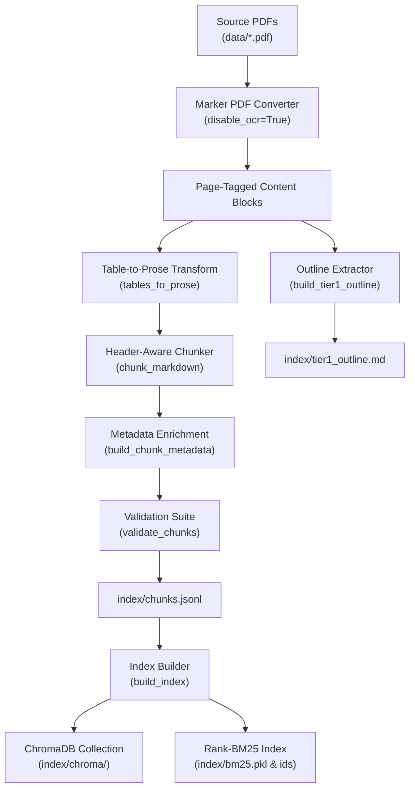

# Ingestion & Knowledge Pipeline: Agentic Ellipsis

This document details the end-to-end knowledge ingestion pipeline that converts raw behavioral science PDF manuals in `data/` into structured, validated chunks and indexed retrieval artifacts.

---

## Important: Copyright, Source Data & Git Policy

The source reference PDFs (`data/*.pdf`) and generated index assets (`index/`) contain commercially published, copyrighted training manuals authored by Chase Hughes.

- **Exclusion from Version Control:** Both `data/*.pdf` and `index/` are strictly excluded from git tracking via `.gitignore` to prevent distributing proprietary, copyrighted content in public repositories.
- **Pipeline Preservation:** All ingestion logic (`app/ingest/`), validation routines, conversion algorithms, and documentation remain open and fully versioned within this codebase.
- **Operator Requirement:** Operators and developers wishing to build or re-index the knowledge base must provide their own legitimately acquired copies of the training manuals inside the `data/` directory before running ingestion.

---

## 1. Pipeline Overview

The pipeline transforms unformatted PDF manuals into dual-indexed knowledge stores (dense vectors in ChromaDB and sparse tokens in BM25) through a multi-stage process:



---

## 2. Ingestion Stages

### Stage 1: Document Parsing with Marker (`app/ingest/pipeline.py`)
PDF parsing is handled by **Marker** (`marker-pdf`):
- `make_converter()`: Initializes a shared `PdfConverter` with `output_format="chunks"` and `disable_ocr=True`. Reusing the converter across all PDFs amortizes model initialization overhead.
- `extract_document_blocks()`: Extracts structural blocks (headings, paragraphs, tables) with associated page numbers (`/page/{n}/`). It uses JSON-mode serialization (`model_dump_json()`) to prevent dict-unhashable type errors during Pydantic serialization.

### Stage 2: Table-to-Prose Transformation (`app/ingest/table_to_prose.py`)
Raw markdown and HTML tables often perform poorly in vector retrieval because row-column relationships and header contexts are lost when sliced into embedding chunks.
- `tables_to_prose()` converts tabular data into fluent, descriptive prose sentences.
- For example, a row in the Behavior Table of Elements:
  - *Table:* `| Code: N-14 | Category: Neck | Deception Score: 3 | Description: Collar pull / ventilating |`
  - *Prose:* `"Behavior element N-14 in category Neck has a deception score of 3, describing collar pull or ventilating behavior."`
- This ensures semantic embeddings capture both the behavioral context and its metric significance.

### Stage 3: Header-Aware Chunking (`app/ingest/chunker.py`)
- `chunk_markdown(text, max_chunk_size=1200, overlap=150)` divides document text into coherent chunks.
- Respects markdown header hierarchies (`#`, `##`, `###`), list items, and paragraph breaks.
- Retains breadcrumb context (e.g., `# Section > ## Subsection`) so individual chunks retain hierarchical context even when isolated during retrieval.

### Stage 4: Metadata Enrichment (`app/ingest/metadata.py`)
Every chunk is assigned a rich dictionary of metadata attributes:
- `source`: Source filename (e.g., `ELLIPSIS-MANUAL-TRAINING-PLANNER-BY-CHASE-HUGHES-2017.pdf`).
- `category`: Topic category (e.g., `btoe`, `authority`, `interview_techniques`, `deception_analysis`).
- `start_page` & `end_page`: Extracted page boundaries from the original PDF.
- `chunk_id`: Deterministic unique identifier (e.g., `btoe_chunk_0042`).
- `tags`: Extracted entity tags and behavior codes.

### Stage 5: Chunk Validation (`app/ingest/validate.py`)
Before passing chunks to the index builder, `validate_chunks()` executes sanity checks:
- Verifies non-empty text content.
- Ensures chunk lengths fall within operational bounds (not exceeding token thresholds).
- Verifies that all required metadata fields (`source`, `chunk_id`, `start_page`) are populated.
- Checks for formatting anomalies or broken table extractions.

### Stage 6: Corpus Outline Extraction (`app/ingest/outline.py`)
- `build_tier1_outline()` extracts a structured markdown outline from all ingested manuals.
- Saved to `index/tier1_outline.md`, providing the agent with a high-level table of contents loaded into memory upon startup (`_load_outline()`).

---

## 3. Dual Index Construction (`app/retrieval/index_build.py`)

Once chunks are generated and validated, `build_index()` constructs the dual retrieval stores:

1. **ChromaDB Vector Store:**
   - Saved to `index/chroma/`.
   - Initialized with collection name `drill_reference`.
   - Uses `GeminiEmbeddingFunction` (calling Gemini's `text-embedding-004`) to compute dense vector embeddings for all chunk texts.
   - Embeddings and metadata are inserted in batches.

2. **Rank-BM25 Lexical Store:**
   - Whitespace and punctuation tokenized using `_tokenize()`.
   - Generates an in-memory `BM25Okapi` scoring model over the corpus.
   - Serializes the BM25 model to `index/bm25.pkl`.
   - Saves chunk ID ordering to `index/bm25.ids.json`.

---

## 4. Ingestion CLI Execution

To run the complete pipeline from terminal:
```bash
python -m app.scripts.run_ingestion
```

### Execution Log Output
```
2026-09-10 10:00:00 [INFO] run_ingestion: Found 4 PDF files in data/
2026-09-10 10:00:02 [INFO] run_ingestion: Parsing AUTHORITY-SELF-ASSESSMENT.pdf...
2026-09-10 10:00:05 [INFO] run_ingestion: Parsing ELLIPSIS-MANUAL-TRAINING-PLANNER...
2026-09-10 10:00:15 [INFO] run_ingestion: Generated 342 chunks across 4 documents
2026-09-10 10:00:16 [INFO] run_ingestion: Validation passed: 342 chunks valid
2026-09-10 10:00:20 [INFO] run_ingestion: ChromaDB vector store populated (index/chroma)
2026-09-10 10:00:21 [INFO] run_ingestion: BM25 index serialized (index/bm25.pkl)
2026-09-10 10:00:21 [INFO] run_ingestion: Ingestion complete.
```
